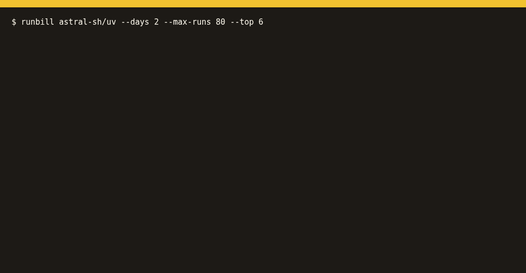

<p align="center"></p>

# runbill

**Which GitHub Actions workflow and job is eating your minutes?**

GitHub's billing page shows one total. The per-workflow `timing` API that used to break it down is
[closing down](https://github.blog/changelog/2025-02-02-actions-get-workflow-usage-and-get-workflow-run-usage-endpoints-closing-down/).
runbill rebuilds the breakdown from the runs and jobs API: billed minutes and estimated cost per workflow
and per job, each job rounded up to the minute the way GitHub bills, with the runner tariff read from labels
(Linux / Windows / macOS / arm / larger runners / self-hosted) and the share of cost spent on re-runs.
Add `--by branch,event` to see which branches and triggers (push, pull_request, schedule, …) run up the bill.



## Install

```bash
pipx install git+https://github.com/Blackman99/runbill    # Python 3.9+, no dependencies
```

Uses `GH_TOKEN` / `GITHUB_TOKEN` or your `gh` login (needs `actions:read`).

## Usage

```console
$ runbill your-org/app --days 30
runbill · your-org/app · runs since 2026-09-10 (97 runs, 320 jobs)

  TOTAL          1,672 billed min       $42.47   (raw 1,510 min, re-runs 12.7%)

  BY WORKFLOW                               runs    billed min        cost   share
  CI                                          60         1,400      $37.80   89.0%
  E2E nightly                                  9           196       $4.31   10.2%
  ...
  TOP 8 JOBS                                jobs    billed min        cost
  CI › test (macos)                           70           490      $30.38
  CI › test (windows)                         70           490       $4.90
```

`--format md|json|csv`, `--workflow ci.yml`, `--rate macos=0.08`, `--fail-over 50` (exit 3 over budget).

Where does the money go: `main`, PR branches, or the nightly schedule? `--by branch,event` adds two tables.
The long tail of PR branches folds into one row, so every table still adds up to the total:

```console
$ runbill your-org/app --by branch,event --top 4
  BY BRANCH                                 runs    billed min        cost   share
  main                                        52           862      $20.81   49.0%
  feat/checkout-v2                             9           180       $4.86   11.4%
  fix/flaky-login-test                         6           120       $3.24    7.6%
  octo-contrib:main                            4            80       $2.16    5.1%
  19 other branches                           26           430      $11.40   26.8%
  (owner:branch = pull request from a fork)

  BY EVENT                                  runs    billed min        cost   share
  pull_request                                41           730      $19.50   45.9%
  push                                        40           640      $16.44   38.7%
  schedule                                     9           196       $4.31   10.2%
  merge_group                                  4            80       $2.16    5.1%
  workflow_dispatch                            3            26       $0.05    0.1%
```

Roll up a whole org or user (repos ranked by cost):

```bash
runbill org your-org --days 30
runbill org your-org --by event    # which triggers cost the most, across every repo
```

Catch the workflow that suddenly got expensive: `--compare` diffs this window against the one right before it (same length), per workflow and per job, biggest cost increase first:

```bash
runbill --compare --days 7                      # last 7 days vs the 7 days before
runbill --compare --days 7 --fail-increase 25   # exit 3 if cost rose more than 25%
```

```text
$ runbill demo --compare
runbill · example/app · last 7 days vs the 7 days before

  now     2026-10-01 09:00 → 2026-10-08 09:00 UTC   97 runs
  before  2026-09-24 09:00 → 2026-10-01 09:00 UTC   93 runs

  TOTAL   $8.26 → $42.47   +$34.20 (+414.0%)   billed min 1,021 → 1,672 (+651)
  Biggest increase: CI +$32.08 (+560.4%), led by test (macos) +$30.38 (new).

  BY WORKFLOW                   min before   min now  cost before   cost now      Δ cost      Δ %
  CI                                   702     1,400        $5.72     $37.80     +$32.08  +560.4%
  E2E nightly                          153       196        $0.92      $4.31      +$3.39  +369.7%
  Release                                –        26            –      $0.05      +$0.05      new
  Docs                                  62        50        $0.37      $0.30      -$0.07   -19.4%
  Benchmarks                           104         –        $1.25          –      -$1.25     gone
  …
```

As a GitHub Action (writes the report to the job summary):

```yaml
permissions: { actions: read, contents: read }
steps:
  - uses: Blackman99/runbill@v0.3.0
    with: { days: 7, fail-over: 20 }
  # or week over week: with: { days: 7, compare: true, fail-increase: 25 }
```

Docs: **https://blackman99.github.io/runbill/docs/** · Estimates at list price, not an invoice. MIT.
